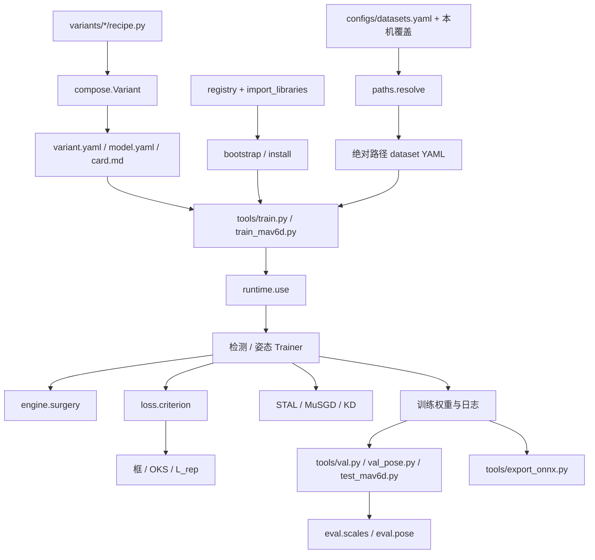
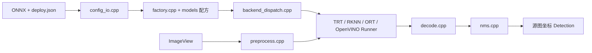

# 当前代码架构

本文描述仓库中已经存在的实现。逐文件职责见 [README 的代码文件索引](../README.md#代码文件索引)，执行命令见 [WORKFLOW.md](../WORKFLOW.md)，研究选型与后续计划见 [PLAN.md](../PLAN.md)。

## 1. 目录与职责

```text
yolo-tod/
├─ src/
│  ├─ tod/                         Python：变体构图、训练、评测
│  │  ├─ __init__.py               注册加载与框架初始化
│  │  ├─ registry.py               模块身份、扩展点、来源与许可证
│  │  ├─ compose.py                Variant DSL 与模型图变换
│  │  ├─ compat.py                 框架版本、配置与运行环境适配
│  │  ├─ paths.py                  数据集注册表与路径解析
│  │  ├─ runtime.py                当前变体上下文
│  │  ├─ data/                    6D 位姿 CSV、数据集绑定与安全增强
│  │  ├─ modules/                 可注册的网络组件
│  │  │  ├─ conv/                 ADown
│  │  │  ├─ attention/            DualAttention
│  │  │  └─ head/                 Efficient_UAVDet 与头分支替换
│  │  ├─ assigner/                STAL 标签分配
│  │  ├─ loss/                    框、关键点、几何损失与准则装配
│  │  ├─ optim/                   MuSGD 及原生优化器适配
│  │  ├─ engine/                  检测/姿态 Trainer、建模后修改、蒸馏
│  │  └─ eval/                    框 AP、OKS 与 ADD/PnP 指标
│  └─ todrt/                      C++17：推理运行时与独立 CMake 项目
│     ├─ include/todrt/           类型、配置、组件与 Detector 接口
│     │  └─ backend/             输入契约、通用外壳与后端入口
│     ├─ src/                    配置、注册、工厂、前处理、解码、NMS
│     │  ├─ models/              模型配方
│     │  └─ backend/             分派、公共流水线与四种 SDK 实现
│     ├─ apps/                   CLI
│     ├─ tests/                  C++ 自检
│     └─ cmake/                  安装包模板与 aarch64 工具链
├─ tools/                        环境、数据转换、训练、评测、消融、导出入口
├─ variants/                     四个变体各自的配方、YAML、卡片与论文笔记
├─ configs/                      数据集注册表、数据模板与标定预设
├─ tests/                        Python 独立自检与可选训练自检
├─ scripts/                      Windows / Bash Git 推送辅助脚本
├─ docs/                         架构、数据契约、训练分析与部署文档
├─ data/、datasets/              本地数据，不入库
├─ results/                      训练与评测产物，不入库
└─ build/、.cache/               构建与运行缓存，不入库
```

`variants/` 保存可追溯的实验组合，`src/tod/modules/` 等目录保存可复用组件。当前没有实现的上采样、额外主干或外部模型目录不列作已有模块。

## 2. Python 调用链



### 注册、构图与训练的边界

1. `register()` 保存组件和元数据。`import_libraries()` 触发注册，`bootstrap()` 再将注册项注入框架解析空间。单独使用注册表和 DSL 时可以不加载完整训练依赖。
2. `Variant` 描述数据、EP 开关、模型变换和训练参数；`materialize()` 将它们落成可审阅的 YAML 与卡片。P2 注入和下采样替换属于模型图变换。
3. `tools/train.py` 解析参数、解析数据路径、进入变体上下文，并按 `task` 选择 Trainer。`train_mav6d.py` 负责机型、MAV6D 数据入口和几何损失开关。
4. `engine.surgery` 负责模型构建后的头分支替换和注意力挂接；`loss.criterion` 负责构造准则，连接框损失、STAL 和姿态损失。
5. `TODPoseTrainer` 通过多重继承复用检测侧接线与框架姿态训练功能；数据集提供 `kpt_shape`。保留框架构造器默认参数，避免传入空 `cfg`。
6. 断点恢复会触发框架重建准则，Trainer 在恢复后重新安装扩展。端到端模型的 O2M/O2O 两套准则都需要覆盖。

`compat.py` 集中承载框架版本、命名空间、YAML 和环境探测适配。Trainer、准则、数据绑定及导出层仍会在各自职责内使用框架接口；变更这些接口时应同时检查相关适配代码与测试。

### 扩展点归属

| 扩展点 | 当前实现位置 | 负责的变化 |
|---|---|---|
| EP0 数据 / 输入 | `data/pose6d.py`、数据工具与 `paths.py` | 数据位置、6D 位姿绑定、监督所需的增强限制 |
| EP1 主干 | `modules/conv/adown.py`、`compose.replace_downsample` | 下采样模块替换 |
| EP2 颈部 | `compose.inject_p2_head` | 增加 P2 融合路径与预测层 |
| EP3 上采样 | `Variant.upsample()` 与图中模块名替换 | DSL 接口已提供；独立自定义上采样算子尚未实现 |
| EP4 注意力 | `modules/attention/dual_attention.py`、`engine/surgery.py` | 在指定特征层挂接双注意力 |
| EP5 输出头 | `modules/head/efficient_uavdet.py`、`engine/surgery.py` | 分组卷积 stem 替换，保留框架输出与解码 |
| EP6 标签分配 | `assigner/stal.py` | 显式启用 / 关闭小目标先验 |
| EP7 损失 | `loss/` | SIoU/WIoU、关键点 OKS、几何 L_rep |
| EP8 推理 / 后处理 | `eval/`、`src/todrt/` | 分层评测与部署端解码、NMS；评测工具也在此说明边界 |
| EP9 训练策略 | `optim/musgd.py`、`engine/distill.py`、Trainer | 优化器、蒸馏与训练准则恢复 |

### 数据位置与配置

`paths.resolve()` 接受注册表名字、数据目录或 YAML 路径，返回统一的 `DatasetPaths`。提交给框架的副本位于 `.cache/tod/datasets/`，其 `path` 已转为绝对路径。

解析优先级为：显式 `--data` 路径 → `--data-root` → `TOD_DATA_ROOT` → 注册表的数据集配置 → 数据集 YAML 的路径兜底。`configs/datasets.local.yaml` 深合并覆盖入库注册表，仅保存机器相关信息。详细命令见 [WORKFLOW §4.0](../WORKFLOW.md)。

## 3. MAV6D 与几何监督

```text
原始 MAV6D + 标定预设
    ↓ mav6d_calibrate.py / mav6d_to_yolo.py
images/{train,val}/ + labels/{train,val}/
labels_6d/{train,val}.csv + dataset.yaml
    ↓ check_pose_dataset.py
paths.resolve → TODPoseTrainer.get_dataloader
    ↓ pose6d_dataset_context
batch: img / bboxes / keypoints / gt_pose / gt_pose_mask / gt_image_size
    ↓ 原生二维准则 + ReprojCriterion
二维损失 + warm-up 后加入的 L_rep
```

需要保留的数值契约：

- 原始 `labels_yolo6d` 是 21 列：类别、9 个二维点和框宽高；源坐标按固定 1920×1080 归一化，转换结果按实际图像宽高重新归一化。
- 原始 `labels` 的相机位姿在 `[1:8]`，机体位姿在 `[9:16]`。四元数采用 `qx,qy,qz,qw`；训练用 `R,t` 将机体坐标变到相机坐标，平移和机体点使用米。
- 转换器先对关键点去畸变，再使用相同针孔内参建立几何监督；训练/验证按序列划分，防止相邻帧泄漏。
- `labels_6d` 的 `obj_index` 与 YOLO 标签行序一一对应。PnP 失败帧可保留二维监督，通过 `gt_pose_mask=False` 跳过几何项。
- 数据集上下文同时替换框架 `dataset` 与 `build` 模块持有的 `YOLODataset` 引用，并在 `finally` 中恢复；建好 loader 后立即验证绑定。
- 启用 L_rep 时关闭不会同步变换 R、t、内参的几何增强。模型关键点解码先由网格单位乘 stride 转成像素，再按图像尺度换算内参。
- L_rep 只惩罚与相机射线垂直的三维偏差。实现采用 GT 框附近的预测锚点，并非完整复用框架正样本分配；这一监督近似及内参缩放限制见训练分析文档。

点编号、CSV 字段、畸变和 PnP 口径分别见 [KEYPOINTS.md](KEYPOINTS.md)、[MAV6D.md](MAV6D.md)、[MAV6D_TRAINING_FLOW.md](MAV6D_TRAINING_FLOW.md) 与 [TRAINING_REVIEW.md](TRAINING_REVIEW.md)。`eval.pose.add_metric` 的真值深度诊断与 `evaluate_pnp_metrics` 的 PnP 完整位姿评测应分开解读。

## 4. C++ 推理架构



### 接口分层

| 层 | 接口 / 实现 | 边界 |
|---|---|---|
| 基础 | `core.hpp/.cpp`、`json.hpp/.cpp` | 错误、日志、枚举、注册元数据与 JSON |
| 数据契约 | `modules.hpp`、`detector_options.hpp` | 图像/张量视图、前后处理参数、模型与运行配置 |
| 装配 | `factory.hpp/.cpp`、`config_io.cpp`、`models/` | 从配置与配方选择 builder、前处理和后处理 |
| 后端选择 | `backend_dispatch.cpp` | 集中解析后端名称与编译可用性 |
| 通用外壳 | `backend/simple_detector.hpp/.cpp` | `IEngineRunner`、异步队列、公共前后处理流水线 |
| SDK 实现 | `engine_{trt,rknn,ort,openvino}.cpp` | 模型载入、设备缓冲、一次执行、数据转换与计时 |
| 应用 | `apps/todrt_cli.cpp` | 配置检查、设备信息、装配说明与性能测试 |

`IEngineRunner::Run()` 接收主机侧输入缓冲，输出必须转换为主机侧 float32；半精度和量化转换在后端内部完成。输入类型、布局和尺寸以引擎契约为准，前处理配置冲突时给出警告。

`ImageView` / `TensorView` 不拥有数据；行步长使用字节。`Submit()` 拷贝图像，调用方可随后复用原缓冲。异步线程与队列在 `AsyncDetectorBase` 中统一维护；同步与异步调用共享推理对象的资源，调用方应避免并发访问同一实例。

前处理负责 letterbox，并保存缩放与补边；解码按部署配置识别 DFL 张量布局；后处理负责 NMS，再将框还原到源图像素坐标。模型结构字段由 Python 导出配置提供，C++ 配方不另行猜测。

| `OutputLayout` | 张量契约 |
|---|---|
| `kAnchorMajorDfl` | `[1, 4*reg_max+nc, A]`；A 为各尺度锚点总数 |
| `kAnchorMajorDflTransposed` | `[1, A, 4*reg_max+nc]`；上述通道/锚点轴的转置布局 |
| `kFeatureMajorDfl` | 各层按 DFL 与类别分数组织后拼接；由 `level_channels`、stride 和输入尺寸确定分段 |
| `kPluginNms` | `[N,6]` 或 `[N,7]`，分别为 `xyxy,score,class` 与前置 batch 索引的结果 |

`reg_max` 是 DFL 分箱数，`strides` 的顺序与头输出一致，`level_channels` 为空时使用默认层通道数。解码器输出网络输入坐标，前处理器的反变换再将它恢复为源图坐标。

`CMakeLists.txt` 独立探测四种 SDK。没有 SDK 时仍可构建公共组件与自检；SDK 后端需在对应硬件验证。`TODRT_NATIVE` 默认关闭，避免本机指令集优化影响跨机器部署。安装包模板支持 `find_package(todrt)` 和 pkg-config。

## 5. 变体和产物

每个 `variants/<name>/` 包含以下文件：

| 文件 | 来源与用途 |
|---|---|
| `recipe.py` | 可执行配方；描述模型、数据、EP 和训练默认值，并提供消融项 |
| `variant.yaml` | 配方物化后的实验配置；训练入口读取 |
| `model.yaml` | 模型结构；不承载完整训练参数 |
| `card.md` | 变体身份、组件、成本和验证状态 |
| `paper-notes.md` | 论文证据、实现差异与尚未确认的假设 |
| `evidence/` | 部分变体的原始取证材料，属于参考资料 |

训练权重、日志和评测 JSON 写入 `results/` 或命令指定位置。部署使用 `export_onnx.py` 生成 ONNX 与部署配置；RK3588 另经 `convert_rknn.py` 转换。物化会更新变体产物，整理注释时无需重新生成模型配置。

## 6. 验证与维护

| 范围 | 现有验证入口 |
|---|---|
| 注册表与模型 DSL | `tests/smoke.py` |
| 路径与注册表覆盖 | `tests/test_dataset_paths.py` |
| 网络组件、优化器、蒸馏 | `tests/test_modules.py` |
| 关键点、损失、6D 数据与评测 | `tests/test_pose.py`、`tests/test_pose6d_swap.py` |
| MAV6D 转换与坐标约定 | `tests/test_mav6d.py`，`--skip-real` 使用合成数据 |
| 仓库跟踪与忽略规则 | `tests/test_repo_hygiene.py` |
| 实际训练循环 | `tests/train_smoke.py`、`tests/train_pose_smoke.py`，按需执行 |
| C++ 配置、装配、解码、NMS | `src/todrt/tests/cpp_smoke.cpp`，通过 CTest 执行 |

新增模块时先确定扩展点并登记元数据，再将它接入配方与对应训练阶段。新增后端时实现公共 runner 契约，添加工厂入口、集中分派与 CMake 探测。

文件内部仅保留简短职责 docstring、工具指令和关键不变量附近的一至两行注释。用法、公式推导、长篇背景、修复经过和性能数字放入 README 或专题文档。修改文件职责或依赖时同步维护本文和 README 索引；测试数量以当前执行输出为准。

### 2026-10-29 整理验证记录

本次只整理注释与文档，保留目录和导入路径。59 个 Python 文件经 AST 比较确认可执行语法结构一致；31 个 C++ 文件经词法比较确认非注释内容一致；4 个 CMake/安装模板经去注释比较确认指令一致。PowerShell 解析及非注释 token 比较通过；两份 Bash 脚本语法检查和环境安装脚本 `--help` 检查通过。Bash 帮助改为直接输出，不再依赖被删除注释的固定行号。

Python 验证环境：Python 3.12.14、torch 2.10.0+cu128、ultralytics 8.4.152。结果如下：

| 检查 | 结果 |
|---|---|
| 架构冒烟 `smoke.py` | 77 项通过 |
| 数据路径 `test_dataset_paths.py` | 33 项通过 |
| MAV6D 工具链 `test_mav6d.py --skip-real` | 46 项通过 |
| 6D 数据集绑定 `test_pose6d_swap.py` | 12 项通过 |
| 仓库卫生 `test_repo_hygiene.py` | 5 项通过 |
| 模块 `test_modules.py` | 102 项通过、1 项失败：分配器 mask 的 Float/Char 类型冲突 |
| 姿态 `test_pose.py` | 219 项通过、2 项失败：测试按序号读取损失项，当前返回值触发 `KeyError: 1` |

模块和姿态的上述失败已在整理前源码上复现，本次未修改相关逻辑。未启动实际训练；按用户要求停止 Windows C++ 编译，C++ 验证限于静态核对，SDK 与目标设备测试留给 Linux 部署环境。
