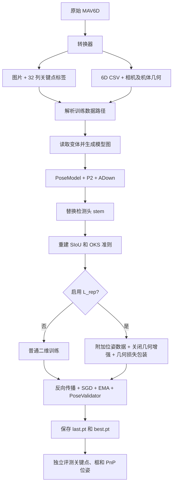

# MAV6D 数据格式、当前训练流程与常见方案对照

整理日期：2026-10-28。依据本工作区当前代码（包含尚未提交的修改）。本文整理逻辑，不修改训练实现，不推定服务器与本机版本一致；服务器失败日志已删除，因此不能确定上一次失败的直接原因。

## 1. 当前任务到底是什么

当前默认组合是 `tools/train_mav6d.py` + `variants/spae-yolov8n-pose/variant.yaml`。

它训练一个**检测框 + 9 个二维关键点**的模型：1 个三维包围盒中心的投影 p0，8 个角点的投影 p1～p8。角点是几何定义的虚拟点，不等同于机体上肉眼可见的零件。

网络采用 YOLOv8 Pose，保留 SPAE 的 ADown、P2、轻量检测头和 SIoU。可选的 `L_rep` 用逐目标 6D 位姿约束二维关键点，但网络没有直接输出旋转和平移的支路。

推理时的完整位姿链是：图像 → 框与二维点 → 对应机型的三维点、相机内参 → PnP → R、t。`tools/test_mav6d.py` 包含这个后处理和评测过程；PnP 不是当前训练循环中的可微模块。

## 2. 三套标签不能混用

### 2.1 作者原始目录

```text
<原始根目录>/
  phantom4/                    # mavic2 使用另一个目录
    JPEGImages/<组>/<序列>/*.jpg
    labels/<组>/<序列>/*.txt
    labels_yolo6d/<组>/<序列>/*.txt
    train.txt
    test.txt
```

原始 `labels/` 不是 YOLO 框标签。原始 `labels_yolo6d/` 也不是 Ultralytics Pose 的直接输入。

### 2.2 原始 labels：一帧 16 个数

当前解析器 `tools/mav6d_calibrate.py::read_pose_file()` 采用以下索引：

| Python 索引 | 字段 |
|---|---|
| `[0]` | 相机时间戳 |
| `[1:4]` | 相机在 VICON 系的位置 x、y、z |
| `[4:8]` | 相机四元数 qx、qy、qz、qw |
| `[8]` | 机体时间戳 |
| `[9:12]` | 机体在 VICON 系的位置 x、y、z |
| `[12:16]` | 机体四元数 qx、qy、qz、qw |

注意：上述两组位姿均处于 VICON 参考系，不可直接作为机体到相机的监督。当前 `_pose_line()` 使用作者固定相机外参 `UTIL_CAM2VICON` 与机体位姿组合：`T_body_to_camera = inverse(T_camera_to_vicon) @ T_body_to_vicon`。函数收到的逐帧 `camera_pose` 并未用于这个组合；固定外参与逐帧相机记录的关系应由真实数据投影核验，不能只根据变量名判断。

### 2.3 原始 labels_yolo6d：一帧 21 列

```text
class x0 y0 x1 y1 x2 y2 x3 y3 x4 y4 x5 y5 x6 y6 x7 y7 x8 y8 w h
```

即 `1 + 9×2 + 2 = 21`。最后两列是宽、高，不是第十个点。

当前代码按固定 1920×1080 还原像素：`u=x*1920`、`v=y*1080`。如果服务器的数据经过裁剪或缩放，必须核对标注仍然采用哪套坐标，不能仅按当前图片尺寸解释原始数值。

### 2.4 转换后目录

```text
<训练根目录>/mav6d/phantom4/
  images/train/*.jpg
  images/val/*.jpg
  labels/train/*.txt
  labels/val/*.txt
  labels_6d/train.csv
  labels_6d/val.csv
  dataset.yaml
  manifest.json
```

转换器把 `<组>/<序列>/<帧>` 拼成图像和标签共用的文件名。当前 `--link` 实际调用 `os.link` 创建硬链接，失败后复制；代码没有创建符号链接。图片像素保持原样。

### 2.5 YOLO-pose：每个目标一行 32 列

```text
class cx cy w h x0 y0 v0 x1 y1 v1 ... x8 y8 v8
```

`1 + 4 + 9×3 = 32`。`cx,cy,w,h` 和关键点 x、y 都是按图片实际宽高归一化的值。

当前转换器先将原始关键点去畸变，再由有效点的包围盒生成检测框；输出点坐标裁剪到 [0,1]。有效性根据**去畸变前**是否位于图内决定：图内写 v=2，图外写 v=0。它没有判断真实遮挡，因此这里 v=2 更准确的含义是“按当前协议参与监督”，不代表确认该角点肉眼可见。

框与关键点 p0 的中心不是同一个概念：`cx,cy` 是二维轴对齐框中心，p0 是三维框中心的投影，透视下不必重合。

### 2.6 旁挂 6D CSV：每目标 9 列

```csv
image,obj_index,tx,ty,tz,qx,qy,qz,qw
01_0101_1,0,0.1,-0.2,3.0,0,0,0,1
```

这一行只是格式示例。`image` 是图像文件名去掉扩展名，`obj_index` 从 0 开始，必须对应同图 YOLO 标签的行序。平移单位米，四元数顺序为 xyzw，变换约定 `P_camera = R @ P_body + t`。

不开 `L_rep` 时普通二维训练不需要 CSV。开启时训练、验证的 loader 都会加载各自 CSV。`pose_strict: false` 允许缺少位姿的图继续做二维训练，该图没有有效位姿的目标跳过几何监督；不代表系统会补全缺失位姿。

### 2.7 dataset.yaml：连接模型、标签与相机

基本字段包括：`path`、`train`、`val`、`names: {0: uav}`、`nc: 1`、`kpt_shape: [9,3]`、`flip_idx: [0,5,6,7,8,1,2,3,4]`。

额外几何字段放在 `tod` 下：

| 字段 | 用途 |
|---|---|
| `camera_matrix` | 对应当前二维坐标系的 3×3 相机内参 |
| `object_points` | 对应 p0～p8 顺序的 9×3 机体坐标，单位米 |
| `pose_labels` | CSV 目录，通常为 `labels_6d` |
| `pose_source` | 原始 VICON 变换或由二维标注 PnP 重建 |
| `pose_strict` | 是否强制每图的位姿数量与目标数一致 |
| `pose_coverage` | 转换产物中的位姿覆盖率统计 |
| `reproj_warmup_epochs` | 几何项的 warm-up 配置，默认 15 |
| `model_diameter` | ADD 阈值使用的模型直径 |
| `source_distortion` | 源相机畸变参数的记录；当前损失不会使用它 |

不要用 RflySim 配置中的示例几何替代 MAV6D 的标定产物。

## 3. 原始数据如何转换

入口：`tools/mav6d_to_yolo.py`。

1. 选择机型；标定优先级为显式 `--calib` → 仓库该机型预置 JSON → 现场标定 → 作者 Phantom 4 几何降级。降级不应当被当成另一机型的可靠标定。
2. 索引图像、解析作者清单。默认从训练清单按**序列**切 train/val；`--use-test-as-val` 才直接使用作者测试清单。默认产物没有单独 test 划分。
3. 将 9 点按 1920×1080 还原为像素，再去畸变，生成 32 列标签。
4. 组合机体到相机位姿，检查深度、距离和重投影一致性。检查不通过时仍可保留二维标签，但不写该帧的 6D 行。
5. 写出图片链接/副本、YOLO 标签、CSV、YAML 和 manifest。

若原始位姿不可用，`--pose-from-pnp` 根据已有二维标签 + K + 三维点重建 CSV；`--fit-pnp-shape` 还会在训练标签上拟合机体尺度。这是派生监督，不是独立测得的 6D 真值。验证集若也用同一二维标签反解位姿，几何自洽不能单独证明真实物理位姿准确。

完整转换分支会删除已存在的 `<out>/<机型>` 再生成。整理和检查阶段不要反复执行完整转换覆盖已有数据。`--yaml-only` 不重做二维标签，也不能修复旧标签的错误坐标。

## 4. 当前代码的实际训练顺序



### 4.1 配置与路径

`train_mav6d.py --model phantom4` 默认从注册表名 `mav6d-phantom4` 找数据，复用 SPAE-pose 变体；变体中保留的 `dataset: rflysim-pose` 不会改变这个专用入口的数据选择。

通用 `tools/train.py` 则默认使用变体的 dataset，所以使用它训练 MAV6D 时必须明确传 `--data`。服务器原始 MAV6D 根目录与转换后训练根目录是两回事，训练入口要求的是转换后的目录/YAML。

`tod.paths.resolve()` 将注册表、机器覆盖或显式路径解析成绝对数据根目录，再生成缓存 YAML 交给框架，避免框架自行误解相对路径。

### 4.2 参数覆盖顺序

专用入口：变体 train 配置 → MAV6D 默认值 → smoke 参数 → 显式 epochs/batch/imgsz/device → `--set` → `L_rep` 安全增强覆盖（显式 `--set` 的增强键例外）。数据、实验名和 `pretrained=False` 在入口中另行指定。

| 参数 | 默认实际值 |
|---|---|
| 图像尺寸 / batch / epochs | 1280 / 4 / 100 |
| optimizer / lr0 / momentum | SGD / 0.01 / 0.937 |
| 预训练 | 不自动迁移，从零训练 |
| AMP / workers | True / 4 |
| pose / kobj | 12 / 1 |
| 框损失 / 关键点损失 | SIoU / TinyPoseLoss（uniform sigma） |
| L_rep | 默认开启，权重配置 1 |
| mosaic / mixup / copy_paste | 0 / 0 / 0 |
| 不开 L_rep 时 | degrees=10、translate=0.1、scale=0.4、fliplr=0.5 |
| 开 L_rep 时 | 上述几何变换及 flip、shear、perspective 等默认关闭 |

`warmup_epochs=3` 是优化器学习率 warm-up；`tod.reproj_warmup_epochs=15` 是几何项 warm-up，两者独立。

### 4.3 模型、数据和 batch

`Variant.model_yaml()` 构建 YOLOv8 Pose 图，添加 stride=4 的 P2，与 P3/P4/P5 一起输出。`TODPoseTrainer` 通过框架 PoseTrainer 构建带 9 点的 PoseModel，再应用 `surgery.apply_spec()` 替换框/分类分支 stem；关键点分支默认不压缩。

普通 batch 包含 `img`、`cls`、`bboxes`、`keypoints`、`batch_idx`。开启几何项时数据集另附 `gt_pose`、`gt_pose_mask` 和 `gt_image_size`。旁挂位姿在框架完成增强后才根据原图文件名附加，**没有跟随增强变换或目标筛选**，这是默认关闭复杂几何增强的原因。

### 4.4 损失

二维部分包括：框定位 SIoU、DFL、分类、OKS 关键点定位、关键点有效性 BCE。OKS 只对 `v!=0` 的点计算；v=1 和 v=2 在当前定位掩码中同样有效。

框架的普通分配器先给预测位置匹配 GT，二维框与点损失使用这些匹配结果。默认 MAV6D 变体没有显式配置 EP6 STAL，也没有开启蒸馏或 MuSGD。

几何部分先从原始关键点预测解码到网格，再乘每个 anchor 的 stride 得像素；随后为每个 GT 框找预测 p0 最接近框中心的候选。它**没有复用二维损失的正样本匹配**。三维点经 `R @ P + t` 变换到相机系，用预测像素对应的相机射线计算横向偏差，并经 smooth-L1 得 `L_rep`。

这不是常规像素重投影误差 `distance(project(RP+t), predicted_uv)`；它是以米为单位的点到射线横向偏差。权重 1 不能直接解释为与二维损失同等影响。

### 4.5 验证、权重和推理

训练时使用框架 PoseValidator，保存权重的 fitness 来自框与关键点指标。当前没有把 PnP 的 ADD 或 10°10cm 接到 best.pt 的选择标准，因此 best.pt 不一定是 6D 指标最优的轮次。

训练目录同时保存以下日志，可按 `epoch` 与框架的 `results.csv` 对齐。

| 日志 | 内容 |
|---|---|
| `[L_rep]` / `pose_train_metrics.csv` | 当前轮的预热/生效状态、产生几何损失的 batch 数、按图像和预测分支计的项数、产生几何项的 batch 上的原始损失均值，以及有 6D 监督的 GT 目标数和占比。分布式模式下 `scope=rank0` 表示仅统计主进程分片。 |
| `[PnP val]` / `pose_val_metrics.csv` | 验证集中带位姿的目标数、PnP 成功和失败数、ADD、ADD(0.5d)、平均旋转与平移误差、10°10cm。误差及阈值命中率以成功解算的目标为分母，`pnp_success_over_targets` 将漏检也计入分母。 |

`train_mav6d.py` 在单进程训练的第 1 轮、每 5 轮和计划的最后一轮随常规验证计算 PnP 指标。用 `--pnp-every N` 调整频率，`0` 关闭。PnP 复用验证的预测框和关键点，使用置信度 ≥ 0.25、框 IoU ≥ 0.5 的匹配口径。只要验证集提供位姿 CSV 和几何参数，`--no-lrep` 训练也可以记录 PnP 指标。

`tools/val_pose.py` 提供本库分层关键点评测；其框 IoU 匹配协议与标准 COCO OKS 匹配协议不同。`tools/test_mav6d.py` 另外做 PnP。当前 PnP 成功率指标只统计匹配到、带 GT 位姿且 PnP 成功的目标，漏检与 PnP 失败需另行报告；不能把这个条件成功率当作全数据集位姿召回率。

## 5. 常见训练方案与本项目的区别

| 方案 | 最少数据 | 网络学习什么 | 推理如何得到位姿 |
|---|---|---|---|
| 普通二维关键点 | 图片、框、固定顺序的二维点和有效性 | 框及二维点；可用坐标回归或热力图监督 | 直接输出二维结构，不自动得到米制 R、t |
| 二维点 + PnP | 上述数据，加对应三维点与 K/畸变模型 | 可以只用二维监督训练网络 | 根据预测二维点解 PnP |
| 二维点 + 几何辅助监督 | 上述数据，加逐目标 R、t | 二维点，并受几何关系约束 | 通常仍需 PnP |
| 直接 6D 回归/稠密对应 | 按方法提供 R、t、CAD/三维对应、掩码等 | 直接姿态或二维到三维的稠密对应 | 回归结果、几何求解或二者组合 |

本项目属于第三种；`--no-lrep` 后属于第二种。训练二维关键点并不天然要求 6D CSV，PnP 也不天然要求先用 6D 损失训练。

普通二维流程通常先固定点序、有效性与数据划分，检查叠加标注，再训练可用的基础网络；增强须同步变换图片、框和关键点。可以迁移预训练特征，但不同关键点数量的输出头不能直接照搬。

加入几何时，额外要求三维单位、坐标系、K、畸变模型和每目标身份对应一致。原始畸变图片 + 畸变像素点应与 K、D 配套；去畸变图片 + 去畸变点应与对应的新 K 配套。裁剪、缩放和补边也必须同步更新相机映射。二维任务可以使用 mosaic，只要标签变换正确；对当前旁挂单相机 R、t 实现则不能直接使用。

参考：[Ultralytics 标签规范](https://docs.ultralytics.com/datasets/pose)、[Ultralytics Pose 训练](https://docs.ultralytics.com/tasks/pose)、[OpenCV PnP 与相机坐标约定](https://docs.opencv.org/4.13.0/d5/d1f/calib3d_solvePnP.html)。这些解释方法和格式，不替代对具体 MAV6D 标注的核验。

## 6. 当前值得优先处理的问题

以下是代码审查结论，不等同于已找到服务器报错原因。

### A. 已能从当前实现确认

1. **L_rep 被广播到 5 个损失分量。** `ReprojCriterion.forward()` 中基础准则返回五维 `total`，随后执行 `total + weight*value`；本机框架训练器最终对它 `.sum()`。结果为 `sum(total) + 5*weight*value`，不是预期的一次几何项。几何损失在图间求和，而二维基础分量已乘 batch_size；需明确整体归一化协议后再调权重。
2. **几何项 warm-up 晚一轮。** epoch 初值 0，轮末才 `update()`，判定却是 `epoch > warmup_epochs`：配置 15 时第 17 个训练 epoch 才启用，配置 0 时第 2 个训练 epoch 才启用。
3. **resume 没有恢复几何项 epoch。** `TODDetectionTrainer.resume_training()` 在框架恢复后重新 `_install_criterion()`；新 `ReprojCriterion` 的 epoch 又变 0，没有对齐 `start_epoch`，会重新经历几何 warm-up。
4. **reproj_weight=0 实际变 1。** `criterion.py` 的 `float(ep7.get('reproj_weight', 1.0) or 1.0)` 会吞掉零值。当前要关闭需用 `--no-lrep`，不能靠权重零做消融。
5. **候选匹配不是代码注释所称的一对一。** `_nearest_anchor_indices_per_box()` 对每个框独立 argmin，没有排除已用候选；多目标可共用一个预测。预测 p0 最近的候选也不一定是检测分配器认定的正样本，且真实 p0 不必等于二维框中心。
6. **部分目标缺失位姿时存在索引错配风险。** `_pose_lookup()` 按 mask 压缩位姿行，`_one_branch()` 却配 `boxes[:n_obj]`。例如仅第二个目标有位姿时，会配给第一个框。当前单目标 MAV6D 路径通常不触发，但不能泛化为可靠的多目标几何训练实现。
7. **几何项单独记录。** 框架 results.csv 仍只记录五项基础损失；几何项的原始均值和实际使用情况见同目录下的 pose_train_metrics.csv。

### B. 需要明确的训练设计

- **图片与二维输出分属不同几何域。** 当前复制原始畸变图，却监督去畸变后的点和框。这可以被定义成“从原图回归理想针孔坐标”，并非数学上绝对不可训练；但它不同于常规图像关键点检测。显示叠加、框定位、翻转/旋转等增强以及最终 PnP 必须遵循同一输出协议。更常规的实现是图像与标签一起去畸变，或保留原始像素标签并在几何损失/PnP 中处理 D。
- **2D baseline 与 +L_rep 同时改变了增强。** 前者默认有旋转、缩放、平移和翻转，后者关闭。直接比较这两条默认命令，无法将变化归因于几何项。需要增加“同样关闭几何增强、但不开 L_rep”的对照。
- **从零训练本身不是错误。** 但自定义结构、OKS sigma、几何损失同时引入后，没有原生 Pose 的锚点结果，会很难判断问题来自数据还是模块。1280、P2、batch 4 也是配置选择，不能仅凭名字保证效果或显存占用。
- **派生 6D 真值限制评测解释。** PnP 重建的 CSV 能验证与二维标签自洽，但不能替代独立测量的位姿精度；低重投影误差也不能独立验证绝对尺度。
- **版本兼容须按实际环境核验。** 上一轮本机 8.4.152 的测试有返回损失项字典导致的测试 KeyError，以及 YOLO26/STAL 掩码类型失败。后者不是默认 YOLOv8 MAV6D 路径，不能直接据此断言服务器 MAV6D 失败原因。

## 7. 后续排查与对照顺序

1. 保留原始数据和当前转换产物；分别核对 train、val 的图像/32 列标签配对、点序和覆盖率。先叠加原始坐标与去畸变坐标，明确网络应该预测哪套点。
2. 在少量数据上先跑普通二维 Pose，不读 CSV，检查是否能拟合；过拟合测试与正式验证集分开。拟合失败时先排标签/坐标/训练接口，不先叠加几何项。
3. 固定增强、划分和初始化策略，比较原生 Pose 与 SPAE-pose 的二维结果。
4. 选择同一组无几何增强配置，比较不开/开启 L_rep；先修正广播、计数、续训与匹配，再解释几何项效果。
5. 用独立验证位姿核对 PnP；同时报告框/点召回、PnP 失败率及位姿误差，保留最终 test 集。

仅检查现有产物的命令示例（路径需对应服务器的转换产物）：

```bash
python tools/train.py --list-datasets
python tools/check_pose_dataset.py --data /path/to/converted/phantom4/dataset.yaml --split train
python tools/check_pose_dataset.py --data /path/to/converted/phantom4/dataset.yaml --split val
```

检查器覆盖结构、配对、数值和部分几何配置，并未对所有真实帧执行完整“R、t 投影 → 二维点”一致性验收。检查通过不等于训练与几何已全部正确。
