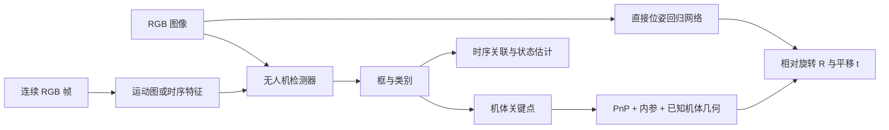

# RGB 目标无人机检测与姿态估计：文献地图和 TOD 复刻路线

检索核验日期：**2026-10-29**。本文面向“用可见光相机观察、检测作为目标的无人机”，覆盖地对空、空对空、鸟类干扰、远距离小目标、RGB 视频运动融合及机体姿态。目的在于建立可扩展的论文变体库。

本文整理 **55 项论文/方法**：20 项小目标与复杂背景网络、7 项鸟机辨识/多目标网络、4 项视频方法、9 项关键点/位姿方法、4 项数据与对照研究、11 项可迁移基础方法。它覆盖了检索到的主要设计路线，并非该方向全部论文的穷尽目录。

## 1. 先明确任务与证据口径

### 1.1 三类容易混淆的“无人机检测”

| 类型 | 图像中的目标 | 本文处理方式 |
|---|---|---|
| 地对空 / 空对空无人机检测 | 无人机本体 | 主体收录：D、B、V 系列 |
| 无人机航拍目标检测 | 车辆、行人等地面物体 | 只作为可迁移组件；VisDrone 成绩不作为目标无人机成绩 |
| 无人机关键点与位姿 | 机体结构点、相对旋转 R 与平移 t | P 系列；区分二维关键点与完整 6D 位姿 |

“抗干扰”在这里主要指鸟/飞机等相似目标、枝叶/建筑/云层杂波、遮挡、模糊、逆光和天气退化。射频抗干扰不属于 RGB 网络的能力范围。带注意力模块不等于已经证明鸟类拒识或恶劣天气鲁棒性，应看相应的独立测试。

### 1.2 如何阅读每条记录

- **来源**优先使用出版社、CVF、arXiv 和作者仓库。年卷与线上日期不同时分别标注；预印本保留其身份。
- **正文核验**表示已取得主要方法段落；**摘要核验**表示当前仅能确认作者摘要/公开概述，不代表已逐式核对网络图和损失。
- 除明确给出代码状态的条目外，均为“**本次未确认作者实现**”，不等于作者没有公开代码。第三方复现与作者实现分别标注。
- **P0/P1/P2** 是结合 TOD 当前能力作出的工程优先级判断；**低/中/高难度**也是本文判断，并非论文结论。
- 当前“已有”指本库已有组件或近似变体，**不等于已经复现原论文的全部结构、训练策略和精度**。

推荐双轨：在作者原始底座上做忠实复现，同时在统一 YOLOv8n/YOLO11n/YOLO26n 底座上做组件迁移。迁移版单独命名，不冒用原论文模型名。



图中是不同研究路线的关系，不表示 TOD 已实现所有分支。多输入视频、SimCC、直接 R/t 输出及关键点的 C++ 解码，均需要对应的导出与运行时适配。

## 2. 优先复刻哪些网络

| 次序 | 推荐对象 | 原因 | TOD 已有基础 | 主要新增工作 |
|---|---|---|---|---|
| 1 | B01 P2-YOLOv8n-ResCBAM | 改动清楚，可直接检验鸟机混淆 | P2 注入、检测训练、分层评测 | ResCBAM、鸟机数据划分、误报统计 |
| 2 | D01 YOLO-Drone | 覆盖高分辨率、下采样、背景抑制三条常见路线 | P2 和图替换 DSL | SPD-Conv、GAM、删除 P5 的图变换 |
| 3 | D07 HWD + CCFM + P2 | 小波下采样与轻量 neck 可复用 | 下采样替换、P2 | HWD、CCFM、P2–P4 结构 |
| 4 | D03 SEB-YOLOv8s | 从轻注意力过渡到稀疏全局交互 | 检测 Trainer、组件注册 | SPD、AttC2f/EMA、BRA |
| 5 | D04 EDGS / D05 DRBD | 头、融合、损失组合有代表性 | 损失替换、头分支修改 | Ghost、BiFPN、RCELAN、相应损失；DCNv2 另排部署验证 |
| 6 | D16 LFE / D08 IASL | 可复用 PConv、EMA、融合、NWD、剪枝 | P2、SIoU、消融入口 | C2fFaster、GSConv/AFPN、NWD、剪枝流程 |
| 7 | D18 YOLOv8-NOVA | 直接针对目标无人机，模块边界较清楚 | 类型替换、模块注册 | NOVA 与原始数据划分核验 |
| 8 | V01 YOLOMG | 有作者实现，覆盖单帧网络缺少的运动证据 | 检测训练和评测基础 | 视频窗口、运动图、双流输入与因果评测 |
| 9 | P01 + P03 | 从本库 9 点几何监督延伸到机体部件关键点 | MAV6D、L_rep、PnP 评测 | 忠实 CPKL-Net、DroneKey 适配与点语义对齐 |
| 10 | D19 CNIFE / D20 UA-YOLO | 背景非局部建模与不确定性方向 | 注意力和训练接线基础 | 跨尺度多输入模块；不确定性公式和实现取证 |

**现有 SPAE 与 SDD 先补真实 UAV 数据实验，再扩充新变体。** 只在 VisDrone 上跑通不足以验收“检测无人机本体”。

## 3. 小目标、复杂背景与轻量化网络

### D01 · YOLO-Drone（2023，Electronics）

- 文献：[YOLO-Drone: An Optimized YOLOv8 Network for Tiny UAV Object Detection](https://www.mdpi.com/2079-9292/12/17/3664)，DOI `10.3390/electronics12173664`。正文主要设计核验。
- 主要创新：加入高分辨率小目标预测路径，并裁掉大目标预测及相关冗余层；以 **SPD-Conv** 减少下采样细节损失；在融合阶段引入 **GAM**。这与单纯给原网络追加第四个头不同。
- TOD：**EP1/EP2/EP4/EP5，P0，中难度**。需分别消融 P2、删除 P5、SPD、GAM，尤其检查近距离大无人机召回是否受损。

### D02 · GF-MDH YOLO（会议 2023，IEEE 收录 2024）

- 文献：[Improved YOLOv8 based on gated fusion and multiple detection head for anti-UAV](https://ieeexplore.ieee.org/abstract/document/10502475)，DOI `10.1109/IAECST60924.2023.10502475`。摘要核验。
- 主要创新：增加高分辨率检测头、去掉最深预测头及对应层；neck 使用**门控融合**，改善不同层特征的细节传递。
- TOD：**EP2/EP5，P1，中难度**。作者使用自建数据；先确认门控计算式、融合位置和原网络图，再与 D01 的 P2–P4 改动共享构图工具。

### D03 · SEB-YOLOv8s（2024，Sensors）

- 文献：[Real-Time Detection of Unauthorized Unmanned Aerial Vehicles Using SEB-YOLOv8s](https://pmc.ncbi.nlm.nih.gov/articles/PMC11207942/)，DOI `10.3390/s24123915`。正文核验。
- 主要创新：**SPD-Conv** 保留浅层细节；把 EMA 结合进 C2f 得到 **AttC2f**；neck 引入 **Bi-Level Routing Attention/BRA**，先筛候选区域，再做细粒度交互。
- TOD：**EP1/EP2/EP4，P0，中难度**。先实现 SPD 与 EMA，再做 BRA；关注高分辨率下的注意力显存及 ONNX/RKNN 算子支持。

### D04 · EDGS-YOLOv8（2024，Drones）

- 文献：[EDGS-YOLOv8: An Improved YOLOv8 Lightweight UAV Detection Model](https://www.mdpi.com/2504-446X/8/7/337)，DOI `10.3390/drones8070337`。正文核验。
- 主要创新：P2 替代 P5 的小目标结构；**C3Ghost/GhostConv** 压缩 neck；**EMA** 抑制背景；用 **DCNv2 构造 DDetect**，适应无人机局部形状变化。
- TOD：**EP2/EP4/EP5，P1，中至高难度**。DUT Anti-UAV、Det-Fly 与 VisDrone 分别属于不同验证域。DCNv2 是额外训练/导出依赖，应和纯标准算子版本分开验收。

### D05 · DRBD-YOLOv8（2024，Sensors）

- 文献：[DRBD-YOLOv8: A Lightweight and Efficient Anti-UAV Detection Model](https://pmc.ncbi.nlm.nih.gov/articles/PMC11598377/)，DOI `10.3390/s24227148`。正文核验。
- 主要创新：深度可分离卷积压缩；在 neck 使用带重参数化的 **RCELAN**；**BiFPN 融合 P2 特征但不额外增加预测头**；**DN-ShapeIoU** 按样本质量调节回归梯度。
- TOD：**EP1/EP2/EP7，P1，中难度**。必须区分“P2 参与融合”与“P2 输出预测”，并验证训练态/部署态重参数化的数值等价。

### D06 · YOLOv7-GS（2024，Drones）

- 文献：[Vision-Based Anti-UAV Detection Based on YOLOv7-GS in Complex Backgrounds](https://www.mdpi.com/2504-446X/8/7/331)，DOI `10.3390/drones8070331`。主要方法核验。
- 主要创新：以 YOLOv7-tiny 为基础，调整先验框；引入 **InceptionNeXt、SPPFCSPC-SR、Get-and-Send**，增强跨层信息融合及复杂背景特征。
- TOD：**EP1/EP2/EP5，P1，高难度**。忠实复现保留 YOLOv7 的 anchor/训练逻辑；迁移版只移植相应组件，不把 YOLOv8 版本称作原模型。

### D07 · 改进 YOLOv11：HWD + CCFM + P2（线上 2024，年卷 2025）

- 文献：[A Lightweight Anti-Unmanned Aerial Vehicle Detection Method Based on Improved YOLOv11](https://www.mdpi.com/2504-446X/9/1/11)，DOI `10.3390/drones9010011`。正文核验。
- 主要创新：**Haar Wavelet Downsampling/HWD** 将低/高频子带编码后降采样；轻量 **CCFM** 替换 neck；新增 P2、删除 P5，面向 DUT Anti-UAV。
- TOD：**EP1/EP2/EP5，P0，中难度**。优先实现无外部小波依赖的固定算子等价版本，但先核对系数、通道顺序和边界处理。
- 代码：[第三方独立复现](https://github.com/2178568050/AntiUAV_Improved_Based_on-YOLOv11)，**不是作者实现，本次未执行或验证其结果**。

### D08 · IASL-YOLO（2025，Drones）

- 文献：[Lightweight UAV Detection Method Based on IASL-YOLO](https://www.mdpi.com/2504-446X/9/5/325)，DOI `10.3390/drones9050325`。主要方法核验。
- 主要创新：以 YOLOv8s 为底座，构造 **C2f-Faster-EMA 增强的 CFE-AFPN**；采用 **SIoU**；使用 **LAMP** 进行参数重要性评估与剪枝。
- TOD：**EP1/EP2/EP4/EP7/EP9，P1，中难度**。SIoU 已有；新增融合网络后单独报告剪枝前后及微调结果，不能把稀疏参数数目直接当实际加速。

### D09 · LAMS-YOLO（2025，Remote Sensing）

- 文献：[A Lightweight Drone Detection Method Integrated into a Linear Attention Mechanism Based on Improved YOLOv11](https://www.mdpi.com/2072-4292/17/4/705)，DOI `10.3390/rs17040705`。正文核验。
- 主要创新：轻量特征提取；**MILA 线性注意力、旋转位置编码、下采样优化和形状感知回归**，兼顾全局上下文与局部小目标信息。
- TOD：**EP1/EP2/EP4/EP7，P1，中难度**。论文消融涉及 MILA、ADown、PP-LCNet、Shape-IoU，不应未经核对就认定所有组件都在最终配置中同时启用。

### D10 · LMWP-YOLO（2025，Scientific Reports）

- 文献：[Improved YOLO for long range detection of small drones](https://www.nature.com/articles/s41598-025-95580-z)，DOI `10.1038/s41598-025-95580-z`。主要方法核验。
- 主要创新：轻量 backbone；**MAFR 多尺度融合/残差与协同注意力**；针对小框偏移的 **NWD 和动态面积权重损失**；配合剪枝，面向 TIB-Net 等远距离 UAV 图像。
- TOD：**EP1/EP2/EP4/EP7/EP9，P1，中难度**。原文的结构、公式与各表配置需进一步逐项对齐，特别核对底座版本、AWLoss 的实际位置及训练划分。

### D11 · YOLOv8-E（2024，Drones）

- 文献：[Lightweight UAV Small Target Detection and Perception Based on Improved YOLOv8-E](https://www.mdpi.com/2504-446X/8/11/681)，DOI `10.3390/drones8110681`。正文核验。
- 主要创新：**C2f-ESCFFM** 结合 Sobel 边缘分支；**CAA + CAHS-FPN** 关联远距离像素与层级特征；**LSCOD** 轻量共享卷积头。
- TOD：**EP1/EP2/EP4/EP5，P1，中难度**。适合研究轮廓证据；增加枝叶、建筑边缘的困难负样本，验证边缘强化是否同时放大背景误报。

### D12 · SPAE-YOLOv8（2026，Sensors；TOD 已有相关实现）

- 文献：[SPAE-YOLOv8 for Onboard Real-Time Perception: Lightweight Small UAV Detection from Air-to-Air Perspectives](https://www.mdpi.com/1424-8220/26/11/3424)，DOI `10.3390/s26113424`。正文及本库取证笔记可用。
- 主要创新：**SIoU、P2、ADown、Efficient_UAVDet 分组卷积检测头**，在空对空小无人机任务中兼顾细节与计算成本。
- TOD：已有 [SPAE-YOLOv8n](../variants/SPAE-YOLOv8n/recipe.py)。优先补 Det-Fly 与 DUT 数据实验，复查分组和通道；头压缩与精度提升分开归因。既有姿态扩展也不能作为原论文检测网络的等价复现。

### D13 · SDD-YOLO（2026，arXiv 预印本；TOD 已有相关实现）

- 文献：[SDD-YOLO: A Small-Target Detection Framework for Ground-to-Air Anti-UAV Surveillance with Edge-Efficient Deployment](https://arxiv.org/abs/2603.25218)。主要结构核验，另见本库论文笔记。
- 主要创新：**P2 高分辨率头**，结合 YOLO26 的 DFL-free/NMS-free 设计及 **MuSGD、ProgLoss、STAL**，面向地对空小目标和边缘推理。
- TOD：已有 [SDD-YOLO26n](../variants/SDD-YOLO26n/recipe.py)，但论文数据 DroneSOD-30K 的公开获取本次未核验。要分别标记框架原生能力和新增组件，不重复计算为本库创新；原论文数字不能填进 TOD 实验结果。

### D14 · MBS-YOLO（2026，Computers, Materials & Continua）

- 文献：[Visual Detection Algorithms for Counter-UAV in Low-Altitude Air Defense](https://www.sciencedirect.com/science/article/pii/S1546221826000159)，DOI `10.32604/cmc.2025.072406`。摘要核验。
- 主要创新：**C2f-Pu** 压缩特征提取；**MB-FPN** 跨级多分支融合；**共享细节增强头** 改善尺度变化。报告 Det-Fly 及 VisDrone 实验。
- TOD：**EP1/EP2/EP5，P1，中难度**。先取得全文明确 Pu、共享层和头部输出定义，不能以名字相近的公共模块代替。

### D15 · PCCS-YOLOv8（2026，Electronics）

- 文献：[PCCS-YOLOv8: An Enhanced Lightweight Detector for Small UAV Detection in Complex Scenes](https://www.mdpi.com/2079-9292/15/15/3247)，DOI `10.3390/electronics15153247`。公开方法概述核验。
- 主要创新：**P2 + CSPPC + SPPELAN + CBAM**，以部分通道计算抵消高分辨率分支的开销，同时聚合上下文、抑制背景。作者报告 RKNN/Orange Pi 部署。
- TOD：**EP1/EP2/EP4/EP5，P1，中难度**。混合 TIB-UAV、Anti-UAV 和自采数据的划分需要核对来源去重；嵌入式 FPS 与单帧延迟须独立实测。

### D16 · LFE-YOLO（2026，Drones）

- 文献：[A Lightweight Feature-Fusion and Small-Target Enhancement Network for Vision-Based UAV Detection](https://www.mdpi.com/2504-446x/10/8/624)，DOI `10.3390/drones10080624`。正文核验。
- 主要创新：**C2fFaster/PConv、GSConv neck、P2–P5 四尺度、EMA、NWD 辅助回归**；另构建 Det-UAV，并报告 DUT 跨数据集及 Jetson TX2 实验。
- TOD：**EP1/EP2/EP4/EP7，P0/P1，中难度**。组件复用价值高；建议先做 NWD，再逐步添加轻量模块，检查精度与真实延迟是否同向变化。

### D17 · LFEM（2025，Drones）

- 文献：[A Lightweight Feature Enhancement Model for UAV Detection in Real-World Scenarios](https://www.mdpi.com/2504-446x/9/12/874)，DOI `10.3390/drones9120874`。主要方法概述核验。
- 主要创新：YOLOv5 中结合 **Ghost 与专用特征增强块**；提出包含复杂背景、视角和不同机型的 **RWSD**，并开展检测器比较。
- TOD：**EP1/EP2，P1，中难度**。可作为轻量特征路线；本次未验证数据实际下载与完整代码，先确认特征增强块细节和数据许可。

### D18 · YOLOv8-NOVA / RealDroneVision（2026，WACV）

- 文献：[RealDroneVision: Dataset and Architecture Advancements for Small-Object Drone Detection](https://openaccess.thecvf.com/content/WACV2026/papers/Sivapuram_RealDroneVision_Dataset_and_Architecture_Advancements_for_Small-Object_Drone_Detection_WACV_2026_paper.pdf)。正文摘要与主要贡献核验。
- 主要创新：真实视频经半自动加人工反馈形成 **173,023 张图像**数据；**NOVA** 替换 C2f，结合深度可分离卷积、尺度感知空洞分支、轻量混合和坐标注意力。
- TOD：**EP1/EP2/EP4，P0/P1，中难度**。适合构造成一个可复用模块。数据量是论文报告值，本次未下载验收；必须核对视频来源分组，避免相邻帧泄漏。

### D19 · CNIFE（线上 2025，年卷 2026，Drones）

- 文献：[CNIFE: Anti-UAV Detection Network via Cross-Scale Non-Local Interaction and Feature Enhancement](https://www.mdpi.com/2504-446X/10/1/8)，DOI `10.3390/drones10010008`。正文核验。
- 主要创新：**CNFI** 用尺度专属 query 与共享 K/V 建立跨尺度非局部交互；**NFE** 结合全局信息与梯度/多分支结构信息。底座与头沿 YOLOv12 路线，验证 DUT 和 Det-Fly。
- TOD：**EP1/EP2/EP4，P1，中至高难度**。多输入特征融合不适合仅用单层 forward hook 表达；需核对正文中的 concat 维度、张量形状与算法描述是否一致。

### D20 · UA-YOLO（2026，Pattern Recognition Letters）

- 文献：[UA-YOLO: An uncertainty-aware network for robust UAV detection](https://www.sciencedirect.com/science/article/pii/S0167865526001662)，DOI `10.1016/j.patrec.2026.04.035`。**摘要核验，全文方法细节待取证**。
- 主要创新：以**不确定性感知特征自校准**降低相似干扰物导致的分类不确定性，并通过轻量结构细化捕捉小目标细节；作者报告四个相关数据集。
- TOD：预计 **EP4/EP5/EP7，P2，高难度待确认**。不能仅用一个置信度阈值就声称复现其不确定性机制；需先取得计算式和训练目标。

## 4. 鸟类干扰、细粒度分类与多无人机

### B01 · P2-YOLOv8n-ResCBAM（2024，IEEE Access）

- 文献：[Enhanced Small Drone Detection Using Optimized YOLOv8 With Attention Mechanisms](https://ieeexplore.ieee.org/abstract/document/10577135)，DOI `10.1109/ACCESS.2024.3420730`。作者摘要核验。
- 主要创新：比较 CBAM、ResCBAM、GAM、ECA，在 neck 结合 **ResCBAM 与 P2 高分辨率头**，直接研究无人机与鸟的分离。
- TOD：**EP2/EP4/EP5，P0，低至中难度**。适合作为第一篇新复刻；保留同输入分辨率下“只加 P2”和“只加 ResCBAM”的对照，并单报鸟→无人机误报。

### B02 · YOLOv11-ResCBAM（2026，Journal of Imaging）

- 文献：[Real-Time Small UAV Detection in Complex Airspace Using YOLOv11 with Residual Attention and High-Resolution Feature Enhancement](https://pmc.ncbi.nlm.nih.gov/articles/PMC13027672/)，DOI `10.3390/jimaging12030140`。主要方法及表格核验。
- 主要创新：在 YOLOv11 中组合 **残差 CBAM 与 P2**，以保留原始特征的残差路径降低弱目标被注意力压制的风险；数据含 drone、bird、airplane。
- TOD：**EP2/EP4/EP5，P1，低至中难度**。与 B01 共享模块，但保留底座差异。论文摘要与不同表格的指标口径需逐表对齐。

### B03 · IMS-YOLOv8（2025，IEEE 会议）

- 文献：[IMS-YOLOv8: A Lightweight and High-Precision Model for Fine-Grained UAV Detection and Bird Discrimination in Complex Airspace](https://ieeexplore.ieee.org/abstract/document/11194433/)。摘要核验。
- 主要创新：**MV2Block、MobileViTBlock、MSCAAttention**，分别负责轻量局部表征、局部/全局交互、多尺度感受野；任务包括七种无人机机型和鸟。
- TOD：**EP1/EP4/EP5，P1，中难度**。同时构建“UAV/bird 粗分类”和“具体机型细分类”评测，避免分类数差异掩盖比较结果。

### B04 · YOLOBirDrone（2026，arXiv 预印本）

- 文献：[YOLOBirDrone: Dataset for Bird vs Drone Detection and Classification and a YOLO based enhanced learning architecture](https://arxiv.org/abs/2601.08319)。摘要核验。
- 主要创新：**AELAN、MPDA、RMPDA** 联合保留形状和多尺度通道/空间信息；同时提出 **BirDrone** 数据集，针对小鸟与小无人机的视觉混淆。
- TOD：**EP1/EP2/EP4，P1，中难度**。不同文献都使用 BirDrone 名称，本次未确认其是否完全同源同版；必须记录来源和图像清单，不能仅按名称合并。

### B05 · YOLOv12-ADBC（2025，Drones）

- 文献：[Study of the Optimal YOLO Visual Detector Model for Enhancing UAV Detection and Classification in Optoelectronic Channels of Sensor Fusion Systems](https://www.mdpi.com/2504-446X/9/11/732)，DOI `10.3390/drones9110732`。主要概述核验。
- 主要创新：比较 YOLOv8–v12；在 YOLOv12 中引入**自适应层级特征整合/多尺度空间融合**，突出鸟与无人机之间的细微差别。
- TOD：**EP2/EP4，P1，中难度**。标题虽提传感融合系统，本文采用的是其视觉检测分支；具体 ADBC 张量计算需进一步核对全文与实现。

### B06 · DotD-YOLOv9-C（2024，Sensors）

- 文献：[A Novel Dataset and Detection Method for Unmanned Aerial Vehicles Using an Improved YOLOv9 Algorithm](https://pmc.ncbi.nlm.nih.gov/articles/PMC11644514/)，DOI `10.3390/s24237512`。方法及结论段核验。
- 主要创新：构建 **Anti2** 数据，包含 UAV、鸟、飞机、直升机四类；在 YOLOv9-C 中以 **Dot Distance/DotD 分配正负样本**，降低小目标匹配的位置敏感性。
- TOD：**EP6，P1，中难度**。应复刻标签分配准则，而非仅将框损失换名；还需核对 DotD 公式、匹配阈值和分支适配。极小目标可增报中心点命中指标，但不取代框 AP。

### B07 · 轻量 YOLOX 无人机群检测（2023，Drones）

- 文献：[A Lightweight Uav Swarm Detection Method Integrated Attention Mechanism](https://www.mdpi.com/2504-446X/7/1/13)，DOI `10.3390/drones7010013`。主要方法/数据段核验。
- 主要创新：以 **YOLOX-Nano、深度可分离卷积、SE/CBAM、DIoU** 构建轻量多目标检测器，在 UAVSwarm 上研究密集和遮挡。
- TOD：**EP1/EP4/EP7，P1，中难度**。这是无人机群检测而非鸟机识别证据；需要单独测密集目标 NMS、遮挡及多目标召回，忠实 YOLOX 与迁移版分开。

## 5. RGB 视频与运动信息

### V01 · YOLOMG（2025，arXiv/作者实现）

- 文献：[YOLOMG: Vision-based Drone-to-Drone Detection with Appearance and Pixel-Level Motion Fusion](https://arxiv.org/abs/2503.07115)；[作者代码与 ARD100](https://github.com/Irisky123/YOLOMG)。本次已核验仓库存在 `models/、train.py、dualdetector.py` 等实现文件，未执行。
- 主要创新：从 RGB 序列产生**像素运动差分图**；通过双分支融合外观和运动，以改进 YOLOv5 backbone/头检测弱小无人机；提出 ARD100 视频集。
- TOD：**EP0/EP1/EP2/EP5/EP9，P0/P1，高难度**。运动图来自 RGB，仍可归为单传感器视频方法；增加视频序列 Dataset、运动处理及双流训练，不要伪装成一个普通注意力层。
- 必做：按视频划分、检验相机自运动与背景运动影响，并分别报告运动预处理、网络与端到端延迟；使用未来帧时明确标记为非因果。

### V02 · F-yolov7（2025，Computing）

- 文献：[F-yolov7: fast and robust real-time UAV detection](https://link.springer.com/article/10.1007/s00607-024-01406-7)，DOI `10.1007/s00607-024-01406-7`。出版社页面核验。
- 主要创新：**背景差分产生潜在目标区域**，再结合 Faster 轻量模块提高 YOLOv7 检测效率。
- TOD：**EP0/EP1/EP8，P1，中难度**。固定摄像头背景差分可作低成本对照；移动相机要另行对齐，不能假定同等有效。还需测静止/悬停目标和慢更新背景下的召回。

### V03 · Dogfight（2021，CVPR；非 YOLO 对照）

- 文献：[Dogfight: Detecting Drones From Drones Videos](https://openaccess.thecvf.com/content/CVPR2021/papers/Ashraf_Dogfight_Detecting_Drones_From_Drones_Videos_CVPR_2021_paper.pdf)。原论文核验。
- 主要价值：通过视频中的运动及跨帧验证处理机载摄像头下的微小无人机；包含时空候选处理与检测后筛选，在 NPS/FL-Drones 上评估。
- TOD：**EP0/EP8/EP9，P2，高难度**。作为视频对照或外部评测适配器；保留其时序窗口、后处理和逐帧采样协议，不与无时间信息的单帧网络直接比较。

### V04 · YOLOv8s-LSTM（2025，Sensors）

- 文献：[Real-Time Detection Sensor for Unmanned Aerial Vehicle Using an Improved YOLOv8s Algorithm](https://www.mdpi.com/1424-8220/25/19/6246)，DOI `10.3390/s25196246`。主要方法核验。
- 主要创新：将连续帧检测框序列交给 **LSTM** 建模目标状态，结合任务损失及 RK3588-A 部署。
- TOD：**EP8/EP9，P1，中难度**。这里的时序信息主要作用于检测输出后的状态序列，不应当成 RGB 特征级融合；单独评估漏检恢复与平滑延迟。

## 6. 无人机机体关键点与 6D 位姿

### P01 · CPKL-Net / MAV6D（2024，IEEE T-RO）

- 文献：[Keypoint-Guided Efficient Pose Estimation and Domain Adaptation for Micro Aerial Vehicles](https://doi.org/10.1109/TRO.2024.3400938)；[作者数据仓库](https://github.com/WindyLab/MAV6D)。本库已有论文 PDF；**本次仓库根目录核验仅见 README，不能标成完整网络代码已开源**。
- 主要创新：质心引导的 **9 点关键点网络**；**L_rep 几何监督**；室内到室外自训练域适应；由关键点恢复目标 6D 位姿。数据提供逐帧位姿与相机/机体信息。
- TOD：**EP0/EP1/EP2/EP5/EP7/EP9，P0，中至高难度**。已有 MAV6D 转换、9 点 Pose、L_rep 与 PnP 指标；原 CPKL-Net、域适应与现有 YOLO-Pose 替代版需要分别命名验收。

### P02 · DronePose（2020，ECCV Workshop）

- 文献：[DronePose: Photorealistic UAV-Assistant Dataset Synthesis for 3D Pose Estimation via a Smooth Silhouette Loss](https://vcl3d.github.io/assets/files/DronePose.pdf)；[作者代码](https://github.com/VCL3D/DronePose)。本次核验存在训练、推理、模型与监督代码。
- 主要创新：合成逼真 UAV 图像，使用**平滑轮廓损失及可微渲染**学习姿态，强调仿真监督与真实图像之间的迁移。
- TOD：**EP0/EP5/EP7，P1，高难度**。需要轮廓、机体模型与渲染监督，不能只用当前框/关键点标签直接复现；适合独立 pose 模型适配。

### P03 · DroneKey（2025，IROS）

- 文献：[DroneKey: Drone 3D Pose Estimation in Image Sequences using Gated Key-representation and Pose-adaptive Learning](https://arxiv.org/abs/2508.17746)；[作者代码/数据](https://github.com/kkanuseobin/DroneKey)。本次核验 `method/` 与 `train.py`。
- 主要创新：Transformer 各层的**中间/紧凑双表征通过门控合并**；**姿态自适应 Mahalanobis 损失**稳定极端姿态下的桨叶关键点；已知机体规格结合 PnP。
- TOD：**EP0/EP5/EP7/EP8，P0/P1，中至高难度**。四个部件关键点与 MAV6D 的质心/包围盒角点不等价；建立独立 layout。可先迁移损失，再做忠实编码器。

### P04 · DroneKey++（2026，arXiv 预印本）

- 文献：[DroneKey++: A Size Prior-free Method and New Benchmark for Drone 3D Pose Estimation from Sequential Images](https://arxiv.org/abs/2602.06211)。摘要核验；本文未确认独立的 ++ 完整代码发布。
- 主要创新：联合**关键点、机型分类、位姿解码**；利用**相机射线几何与类别嵌入**，减少推理时人工输入机体尺寸/网格的需求；提出 6DroneSyn。
- TOD：**EP0/EP5/EP7，P1，高难度**。需要类别及 6D 数据；“无需手工尺寸”不意味着解决任意未知机型的单目绝对尺度可观测性，必须做未见机型验证。

### P05 · UVPose（2025，Drones）

- 文献：[UVPose: A Real-Time Key-Point-Based Skeleton Detection Network for a Drone Countermeasure System](https://www.mdpi.com/2504-446X/9/3/214)，DOI `10.3390/drones9030214`。正文核验。
- 主要创新：MMPose 的 **top-down** 框架；**MDA-Net 多尺度/并行注意力、RFN 融合、优化 SimCC** 定位机体关键点。
- TOD：**EP1/EP2/EP5/EP7，P1，高难度**。是二维机体骨架模型，不自动等价于 6D；应先做“检测器 ROI → UVPose”外部基线，再决定迁移模块。

### P06 · AeroMotion6D（2026，Robotics）

- 文献：[Real-Time Temporally Consistent Monocular 6D UAV Pose Estimation for Onboard Aerial Perception](https://www.mdpi.com/2218-6581/15/8/145)，DOI `10.3390/robotics15080145`。公开方法段核验。
- 主要创新：YOLO11s 检测前端，结合**Persistent Pose Memory、Adaptive Context Fusion、时序姿态解码与运动约束**，侧重轨迹稳定与旋转连续性。
- TOD：**EP0/EP5/EP7/EP9，P2，高难度**。需连续姿态序列与专用 decoder；除平均误差外，报告抖动、漂移、遮挡恢复，严格区分因果在线输入和离线窗口。

### P07 · MF-UAVPose6D（2026，arXiv 预印本；固定翼）

- 文献：[MF-UAVPose6D: A Model-Free Monocular 6-DoF Pose Estimation Framework for Fixed-Wing UAVs](https://arxiv.org/abs/2606.29697)。摘要核验。
- 主要创新：**热图中心锚点、Perspective-Aware Module、Dynamic Topological Sampling、平移/旋转解耦**；推理输入 RGB 与内参，提出 FW-UAV6DPose 合成集。
- TOD：**EP0/EP5/EP7，P2，高难度**。固定翼几何与当前旋翼 MAV6D 不同；需要新数据和 pose head。论文提出的数据不代表本次已确认可下载。

### P08 · YOLO6D（2018，CVPR；通用刚体参考）

- 文献：[Real-Time Seamless Single Shot 6D Object Pose Prediction](https://arxiv.org/abs/1711.08848)。原论文路线核验。
- 主要创新：单阶段预测三维包围盒点的二维投影，再通过**已知几何 + PnP** 求刚体位姿。
- TOD：**EP5/EP8，P1，中难度**。作为 9 点 + PnP 基线有直接参考价值；其通用物体结果不属于无人机实验。PnP 所需内参、米制尺寸和坐标约定必须显式提供。

### P09 · Yolo-Key-6D（2026，VISAPP/arXiv；通用刚体参考）

- 文献：[Yolo-Key-6D: Single Stage Monocular 6D Pose Estimation with Keypoint Enhancements](https://arxiv.org/abs/2603.03879)。摘要与会议论文概述核验。
- 主要创新：以 3D 框角点投影为辅助任务，**直接回归平移/旋转**；旋转采用 **9D 表征 + SVD 投影到 SO(3)**，在 LINEMOD/Occluded 上评估。
- TOD：**EP5/EP7，P2，高难度**。需要直接位姿输出与相应梯度/旋转约束；把普通 YOLO-Pose 接 PnP 不能称为复现本方法。

**姿态验证要点：** 二维点 AP、PnP 成功率、旋转角误差、平移误差、ADD/ADD-S 和 10°10cm 分开统计；同时报告检测失败对完整系统成功率的影响。机体近似对称、不可见点和极少像素目标需单列，不能仅报告已成功检测 ROI 的姿态精度。

## 7. 数据、恶劣天气与非 YOLO 对照

### C01 · UAV-DETR（2026，arXiv；非 YOLO）

- 文献：[UAV-DETR: DETR for Anti-Drone Target Detection](https://arxiv.org/abs/2603.22841)；[论文给出的作者代码](https://github.com/wd-sir/UAVDETR)。本次确认论文包含此链接，未执行代码。
- 主要创新：**WTConv backbone、SWSA-IFI 滑窗注意力、ECFRFN 跨尺度重校准融合、Inner-CIoU + NWD**。
- TOD：**P1，外部对照/组件迁移**。适合检验收益是否依赖 YOLO 头；完整 DETR 训练器不能仅通过现有 YOLO 模块注册实现。

### C02 · 复杂背景与雨天检测研究（2024，WACV Workshop）

- 文献：[Investigation of UAV Detection in Images With Complex Backgrounds and Rainy Artifacts](https://openaccess.thecvf.com/content/WACV2024W/RWS/papers/Munir_Investigation_of_UAV_Detection_in_Images_With_Complex_Backgrounds_and_WACVW_2024_paper.pdf)。原论文检索摘要核验。
- 主要贡献：将**天空、复杂背景、雨天伪影**分开测试，比较常见检测器在不同退化域下的表现；侧重数据/协议而非提出一个 YOLO 注意力块。
- TOD：**EP0/评测，P0，低至中难度**。优先复刻条件分层与误报分析，作为所有“抗干扰”网络的共同验收集。

### C03 · SynDroneVision（2025，WACV）

- 文献：[SynDroneVision: A Synthetic Dataset for Image-Based Drone Detection](https://openaccess.thecvf.com/content/WACV2025/papers/Lenhard_SynDroneVision_A_Synthetic_Dataset_for_Image-Based_Drone_Detection_WACV_2025_paper.pdf)；[作者数据发布](https://zenodo.org/records/13360116)。原论文核验。
- 主要贡献：游戏引擎中控制**机型、背景、光照**并自动生成 RGB 标注；比较合成/真实混合训练，降低真实采集成本。
- TOD：**EP0/EP9，P1，中难度**。为多个网络共享同一套 sim-to-real 训练方案；合成数据收益必须在独立真实测试集上验收。

### C04 · SynDroneVision-Weather / SDV-W（2026，arXiv 预印本）

- 文献：[Beyond Clear Skies: Synthetic Seasonal and Weather Variations for Real-World Drone Detection](https://arxiv.org/abs/2608.16191)。作者摘要核验。
- 主要贡献：构造**季节与雨/雪/雾强度可控、轨迹/场景可匹配**的合成数据，支持干净—退化配对比较；作者报告 55,187 张图像。
- TOD：**EP0/EP9，P1，中难度**。截至本次核验，摘要仍写“论文接收后发布”，**不能标成数据已获取**；先保留适配计划。

## 8. 可迁移基础方法：减少重复实现

这些论文不是 RGB 目标无人机的直接实验结论；它们提供多篇魔改 YOLO 共同使用的组件或评测思路。

| ID | 文献与链接 | 主要创新 | TOD 接入与限制 |
|---|---|---|---|
| G01 | [A Normalized Gaussian Wasserstein Distance for Tiny Object Detection](https://arxiv.org/abs/2110.13389)，2021 预印本；[作者代码](https://github.com/jwwangchn/NWD) | 用二维高斯建模框，以归一化 Wasserstein 距离缓解 tiny 框对像素偏移的敏感性 | **EP7 优先、EP6/EP8 后续，P0**。损失/匹配/NMS 是三种独立实验；归一化常数必须与坐标单位一致 |
| G02 | [RFLA: Gaussian Receptive Field based Label Assignment for Tiny Object Detection](https://arxiv.org/abs/2208.08738)，ECCV 2022；[作者代码](https://github.com/Chasel-Tsui/mmdet-rfla) | 高斯感受野距离与层级标签分配，让微小 GT 获得有效监督 | **EP6，P1**。与 TAL/STAL 匹配接口和质量分数定义不同，不能只更换一个 IoU 函数 |
| G03 | [Slicing Aided Hyper Inference and Fine-tuning for Small Object Detection](https://arxiv.org/abs/2202.06934)，ICIP 2022；[SAHI](https://github.com/obss/sahi) | 切片推理、切片训练与重叠结果合并 | **EP0/EP8，P0**。补切片边界处理和大目标整图支路；计算量及端到端延迟随切片数增长 |
| G04 | [QueryDet: Cascaded Sparse Query for Accelerating High-Resolution Small Object Detection](https://openaccess.thecvf.com/content/CVPR2022/html/Yang_QueryDet_Cascaded_Sparse_Query_for_Accelerating_High-Resolution_Small_Object_Detection_CVPR_2022_paper.html)，CVPR 2022；[作者代码](https://github.com/ChenhongyiYang/QueryDet-PyTorch) | 低分辨率候选位置引导高分辨率稀疏计算 | **EP2/EP5/EP8，P2**。完整稀疏执行不等于普通 P2 头，部署与算子成本较高 |
| G05 | [No More Strided Convolutions or Pooling: A New CNN Building Block for Low-Resolution Images and Small Objects](https://arxiv.org/abs/2208.03641)，2022 | SPD 将空间信息重排到通道，再用非步进卷积处理 | **EP1，P0**。需核对通道排列、后续卷积与奇数尺寸处理；与 ADown/HWD 做同预算比较 |
| G06 | [Efficient Multi-Scale Attention Module with Cross-Spatial Learning](https://arxiv.org/abs/2305.13563)，2023 | 分组多尺度分支与跨空间交互，避免简单通道压缩丢失信息 | **EP4，P0**。这是注意力 EMA，和训练权重的 exponential moving average 不是同一概念 |
| G07 | [BiFormer: Vision Transformer With Bi-Level Routing Attention](https://openaccess.thecvf.com/content/CVPR2023/html/Zhu_BiFormer_Vision_Transformer_With_Bi-Level_Routing_Attention_CVPR_2023_paper.html)，CVPR 2023；[作者代码](https://github.com/rayleizhu/BiFormer) | 粗区域路由后，仅在候选区域内进行 token 交互 | **EP4，P1**。支撑 SEB 等方案；须报告高分辨率注意力显存与部署延迟 |
| G08 | [Learning to Upsample by Learning to Sample](https://arxiv.org/abs/2308.15085)，ICCV 2023；[DySample 作者代码](https://github.com/tiny-smart/dysample) | 用学习采样位置代替动态卷积生成上采样特征 | **EP3，P1**。DSL 已有入口但 TOD 尚无实现；grid/sample 类算子的目标后端支持需单独核验 |
| G09 | [CBAM: Convolutional Block Attention Module](https://arxiv.org/abs/1807.06521)，ECCV 2018 | 通道与空间注意力顺序细化特征 | **EP4，P0**。ResCBAM 是在此基础上添加残差的变体；不能把本库现有 DualAttention 默认视作公式等价 |
| G10 | [EfficientDet: Scalable and Efficient Object Detection](https://arxiv.org/abs/1911.09070)，CVPR 2020 | 可学习加权的双向特征金字塔 **BiFPN** 与复合缩放 | **EP2，P1**。完整拓扑、融合权重归一化、重复次数均要明确，不能仅用加权加法代表整套 neck |
| G11 | [TPH-YOLOv5: Improved YOLOv5 Based on Transformer Prediction Head for Object Detection on Drone-captured Scenarios](https://arxiv.org/abs/2108.11539)，ICCV Workshop 2021 | 高分辨率预测路径与 Transformer 预测头等策略，针对航拍尺度变化 | **EP2/EP5，P2**。主要是 VisDrone 地面目标；只能作为可迁移设计，不能列作已验证无人机本体检测网络 |

RFLA 本文使用原论文 **`2208.08738`**，新增引用不要沿用名称相近论文的 arXiv 编号。上表作者链接来自论文/项目公开说明；除第 10 节列出的仓库外，本次未逐仓执行验证。

## 9. 数据集与任务对应

| 数据 / 官方入口 | 模态和标签 | 适合解决的问题 | 在 TOD 中的使用原则 |
|---|---|---|---|
| [DUT Anti-UAV](https://github.com/wangdongdut/DUT-Anti-UAV)；[论文](https://arxiv.org/abs/2205.10851) | 可见光；检测 10,000 图及独立跟踪视频 | 地对空无人机本体、复杂背景、跨域验证 | 第一检测主基准；保留官方 train/val/test，不把跟踪首帧框当通用检测协议 |
| [Det-Fly](https://github.com/Jake-WU/Det-Fly) | RGB 空对空框标注 | 机载视角、尺度和背景变化 | 与 DUT 构成双域测试；同一底层视频的相邻图像避免跨集合 |
| [ARD100 / YOLOMG](https://github.com/Irisky123/YOLOMG) | RGB 视频与目标框，论文报告 100 视频 | 极小目标、相机运动、外观/运动融合 | 优先使用作者划分，训练/评测都保留时序与预处理成本 |
| [NPS-Drones](https://engineering.purdue.edu/~bouman/UAV_Dataset/) | 机载 RGB 视频框 | 远距离空对空、视频方法迁移 | 按序列评测，记录具体下载版本与采样方式 |
| [Anti-UAV300 / 官方 Anti-UAV 项目](https://github.com/ZhaoJ9014/Anti-UAV) | RGB 与 IR 视频、框及可见性 | 长期消失/重现、背景干扰 | 本任务只取 **RGB**；官方说明 **410/600 仅 IR**，不混入纯 RGB 主结果 |
| [MAV6D](https://github.com/WindyLab/MAV6D) | RGB、关键点相关标签、相机/机体 6D 位姿 | 9 点、相对位姿、L_rep 与 PnP | 复用本库转换器，但训练文件必须保留标定和坐标单位 |
| [DroneKey / 2DroneKey / 3DronePose](https://github.com/kkanuseobin/DroneKey) | 机体部件关键点与姿态 | 桨叶关键点、极端姿态、几何恢复 | 与 MAV6D 分 layout；核验机型尺寸、标定和点对应关系 |
| [DronePose / UAVA](https://github.com/VCL3D/DronePose) | 合成图像、模型/轮廓及姿态相关监督 | 轮廓损失、sim-to-real | 建立独立监督适配，不能只生成 YOLO 框就宣称数据等价 |
| BirDrone / Drone-vs-Bird | 见 B01/B04/B05 原文的数据入口，来源命名存在重叠 | 鸟类干扰、细粒度误报 | 本次未确认统一官方版本；入库前固定来源、类别、哈希和 split |
| RealDroneVision / RWSD / Det-UAV | 分别见 D18/D17/D16 作者论文 | 更丰富的真实场景、跨数据集泛化 | 本次未下载核验，不填“已就绪” |
| [SynDroneVision](https://zenodo.org/records/13360116) / SDV-W | 合成 RGB、多机型、光照/天气变化 | 数据扩充、域泛化、退化实验 | SDV 有发布入口；SDV-W 发布状态见 C04，真实测试集保持独立 |

TIB-Net/TIB-UAV、UAVSwarm 等在多篇论文中出现，但镜像、版本与公开获取方式需继续逐项核验。不要根据二次整理仓库或数据集名称就假定许可、标注和划分相同。仓库代码许可证也不自动覆盖数据及权重。

## 10. 哪些代码真的核验过

| 项目 | 本次核验到的内容 | 对复刻的意义 |
|---|---|---|
| [Irisky123/YOLOMG](https://github.com/Irisky123/YOLOMG) | 根目录含 `models/`、`utils/`、`train.py`、`val.py`、`dualdetector.py`、LICENSE 等 | 可作为忠实视频复现起点；尚未安装、训练或验证指标 |
| [kkanuseobin/DroneKey](https://github.com/kkanuseobin/DroneKey) | `method/`、`train.py`、README 与数据入口 | 有实现文件；数据、依赖完整性和权重仍需验收 |
| [VCL3D/DronePose](https://github.com/VCL3D/DronePose) | `models/`、`supervision/`、`train.py`、`infer.py` 等 | 有网络与监督实现，需单独的渲染/模型适配 |
| [WindyLab/MAV6D](https://github.com/WindyLab/MAV6D) | 仓库根目录仅 README；README 给出数据和格式说明 | **数据公开入口，不是完整 CPKL-Net 源码交付** |

核验“有源文件”与“可复现”是不同阶段。真正进入 `reproduced` 状态前还需固定 commit、依赖、数据 split、权重来源、训练命令和原始结果；目前本文不替任何新项目宣告训练成功。

## 11. 在 TOD 中如何组织大批复刻

### 11.1 先建共享组件，再写变体配方

| 组件簇 | 涉及论文 | 建议接入位置 | 当前状态 |
|---|---|---|---|
| P2、P2–P4 / P2–P5 拓扑 | D01/D02/D04/D07/D12/D13、B01/B02 | `compose.py` 图变换、各变体 `model.yaml` | P2 注入已有；删除 P5/对应冗余路径需新增可审阅变换 |
| SPD、HWD、ADown | D01/D03/D07/D09/D12 | `modules/conv/`，EP1 | ADown 已有；SPD/HWD 待实现 |
| EMA、CBAM、ResCBAM、GAM、BRA | 多篇 D/B 系列 | `modules/attention/`，EP4 | 仅现有 DualAttention，不能直接替代所有注意力 |
| Ghost、PConv/C2fFaster、NOVA、RCELAN | D04/D05/D08/D16/D17/D18 | `modules/conv/` 或新建职责明确的 block 包 | 待实现；重参数化需独立等价验证 |
| BiFPN、AFPN、CCFM、CNFI | D05/D07/D08/D19 | 新建 `modules/neck/`，EP2 | 目前没有完整 neck 组件库，多输入模块要补解析适配 |
| SIoU、NWD、ShapeIoU/DN-ShapeIoU、DotD | D05/D08/D09/D10/D16、B06 | `loss/`、`assigner/`，EP6/EP7 | SIoU/WIoU 已有；其余待实现或取证 |
| 轻量/共享/可变形头 | D04/D11/D12/D14 | `modules/head/`、`engine/surgery.py`，EP5 | 分组 stem 替换已有；新输出契约需另做适配 |
| RGB 运动图/视频窗口 | V01/V02/V03 | 新建 `data/video.py` 与相应流程，EP0 | 待实现；当前 `runtime.use()` 不是时序状态管理器 |
| 关键点、PnP、直接位姿回归 | P 系列 | `data/`、`modules/head/`、`loss/`、`eval/pose.py` | 9 点和 PnP 基础已有；直接 R/t head 与 SimCC 待实现 |
| 剪枝、跨域自训练、视频蒸馏 | D08/P01 等 | `engine/`，EP9 | 现有 KD 可复用部分接线，尚无完整剪枝/伪标签流程 |

表中“新建”是未来实施建议，本次文献整理没有创建这些空目录，也没有把未实现模块登记为已有。

### 11.2 分阶段路线

**阶段 A：任务基准与小改动。** 固定 DUT 检测和 Det-Fly；准备鸟类/飞机困难负样本；跑 YOLOv8n 原生、P2、P2–P4、SPAE、SDD。补 G01 NWD 与 B01 ResCBAM。先得到可比较的目标无人机基线。

**阶段 B：复用率最高的组件。** 实现 SPD/HWD/EMA/GAM/CBAM、Ghost/PConv、BiFPN/CCFM/AFPN，再组合 D01/D03/D04/D05/D07/D08/D16。每个模块都能被 `without()` 消融；多项改动不能只有一条整包配置。

**阶段 C：较新网络与精细干扰。** D18 NOVA、D19 CNIFE、B03/B04/B05；按背景/鸟机/尺度分桶验证。UA-YOLO 等全文不完整的方案暂不伪造实现。

**阶段 D：视频。** 以 YOLOMG 作者仓库作原始对照，再把视频输入和模型组件迁入 TOD；F-yolov7、LSTM 输出建模及 Dogfight 对照保持各自输入和因果口径。

**阶段 E：机体姿态。** 先 MAV6D 的 2D-only → PnP → L_rep，再 DroneKey/UVPose，最后直接 R/t 和时序姿态。每套关键点定义单独配置，避免把机体角点、桨叶中心和人体关节混用。

针对当前 8 GB 级显存环境，优先 n 规模与单项消融；s 规模忠实复现和高分辨率视频实验按实际显存单独排程。该顺序是工程建议，不承诺某分辨率和 batch 一定可用。

### 11.3 每个变体的交付物

```text
variants/<dataset>-<base>-<paper-shortname>/
  recipe.py          模块组合、训练默认值、单项消融
  variant.yaml       可审阅实验配置
  model.yaml         明确的网络图
  card.md            状态、成本、任务和复现边界
  paper-notes.md     原文公式/图号、代码来源、实现决策和未决项
  evidence/          必要取证材料与元数据
  results.json       实验完成后生成，未完成时不填论文分数
```

建议在卡片记录 `reproduction_mode: faithful | transferred`、论文版本、作者代码 URL/commit、数据 manifest、输入模态、是否时序/因果、底座及框架版本、关键点 layout、随机种子和部署硬件。上述字段是拟议的实验记录约定，现有 DSL 尚未自动验证全部字段。

## 12. 统一评测，才能比较“抗干扰”和“小目标”

| 维度 | 至少报告 | 用途 |
|---|---|---|
| 普通检测 | AP50、AP50:95、P/R、每类 AP | 防止只引用最好看的单阈值结果 |
| 原图尺度 | `sqrt(w*h)` 的 `<8`、`8–16`、`16–32`、`32–64`、`≥64` px 分桶 | 区分真正 tiny UAV 与大目标；分桶是建议新增的统一协议 |
| 输入尺度 | 记录 resize/letterbox 后尺度、输入分辨率、SAHI 切片大小 | 区分网络改动与等效放大收益 |
| 相似目标 | bird→UAV、airplane→UAV 的混淆数；纯负样本 FP/image | 衡量鸟机拒识，而不是仅看 UAV 正样本 mAP |
| 复杂背景 | 天空、云、建筑、植被、地面等分层 | 查看注意力/边缘/上下文模块的实际收益 |
| 天气与图像退化 | 雨/雾/雪/逆光/模糊的独立及配对结果 | 区分真实退化与简单增强；强度分级，不混成一个数 |
| 开放场景 | 无无人机帧的误报；固定误报预算下召回 | 避免在只有正样本的测试集上夸大可用性 |
| 视频 | 事件召回、误报事件/小时、首次发现延迟、连续漏检、恢复时间 | 发现平滑/运动方法对在线表现的收益与代价 |
| 姿态 | 点误差/OKS、PnP 成功率、旋转/平移、ADD(-S)、10°10cm | 不能用二维点 AP 代替米制位姿精度 |
| 部署 | batch=1 的预处理/网络/后处理/总延迟、p50/p95、显存和功耗设置 | 论文 FPS 只能在相同计时范围和硬件上比较 |

当前 `eval/scales.py` 已有尺寸分层基础；原图与网络输入双尺度、负样本误报预算、事件级视频评测尚需补充，不能把本节协议写成已有功能。阈值只在验证集选择，测试集固定；多次随机种子报告均值与波动。

所有视频数据按**视频/拍摄场次**分组；多源图片先去重，再划分；同一原图的切片和增强只进入同一个集合。鸟、飞机等既可做显式类别，也可作为拒识负样本，两种协议分别报告。已标注 UAV-only 的数据不能自动假定其他可见物体都有可靠鸟类标签。

## 13. 暂不放入纯 RGB 主表的方向

- **IR-only 与 RGB-T**：Anti-UAV410/600、S-Drone-YOLO、许多红外点目标分割和双模态融合方法。可建立扩展分支，但需独立模态及数据协议。
- **航拍人体姿态**：[FlyPose: Towards Robust Human Pose Estimation From Aerial Views](https://arxiv.org/abs/2601.05747) 检测人体关键点，不能作为机体姿态网络；TOD 的 VisDrone-Pose 变体也属于不同任务。
- **名称相同的 YOLO-Drone**：D01 是 2023 年 Electronics 的目标无人机检测论文；其他同名航拍目标、GhostHead 或个人工程不能未经核对就合并。
- **仅微调原生 YOLO 的应用工程**：可作部署案例；若没有清楚的结构、损失或训练机制变化，不作为一个新的网络架构重复收录。

继续扩展时，优先从上述文献的参考文献与作者项目追溯原文；对于只找到二次博客、找不到方法细节或日期不明的名字，先进入待核验清单。这样能够逐步覆盖更多魔改网络，同时保留可追溯、可消融和可比较的实验结果。
